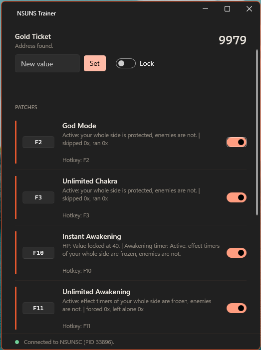
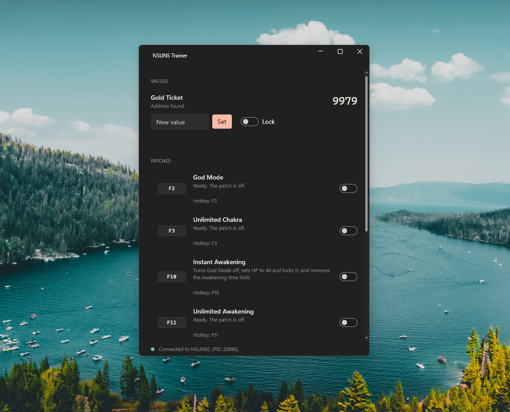
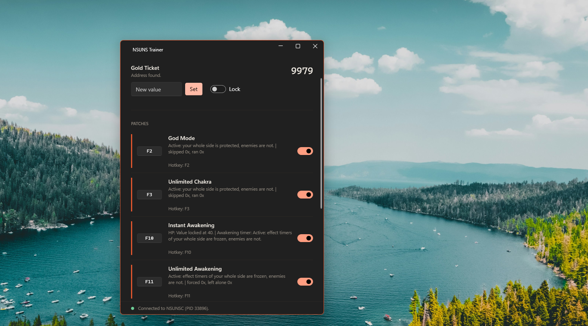
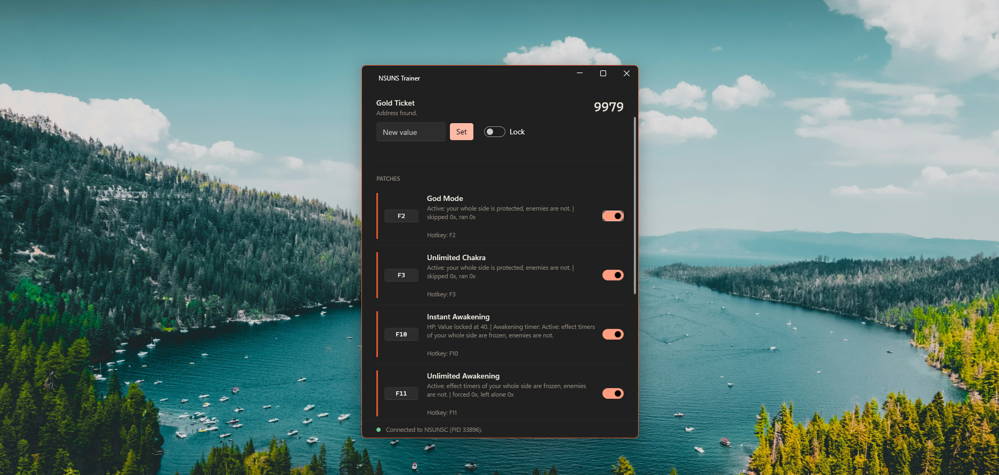

# NSUNS Trainer

**A small, standalone trainer for Naruto x Boruto: Ultimate Ninja Storm Connections.**

One `.exe`. No setup, no config files, no extra tools. All addresses, signatures, patches and hotkeys are built in.

> Your whole side is protected. Enemies are not affected.

---

## Features

| Feature | Default hotkey | What it does |
|---|---|---|
| God Mode | `F2` | Your whole team takes no damage. Works with sub-characters and in mirror matches. |
| Unlimited Chakra | `F3` | Your whole team keeps its chakra. |
| Instant Awakening | - | One switch that prepares everything for Awakening. See below. |
| Unlimited Awakening | - | The Awakening timer of your whole side does not run out. Enemy Awakening still ends normally. |
| Team Tag | `F4` | Call your partner (RB / LB on a controller, Q / U on keyboard) with no cooldown. Spam it freely. |
| Tag Switch | `F7` | Swap characters in team mode with no cooldown. Switch as often as you like. |
| Unlimited Kawarimi | `F9` | Substitution Jutsu without running out. |
| Unlimited Team Bar | `F5` | Locks the Team Bar at 100. |
| Gold Ticket | - | Read, set, or lock your Gold Ticket count. |

Every hotkey can be changed inside the app. Hotkeys work globally, even while the game has focus. Instant Awakening and Unlimited Awakening have no default hotkey: type one in the box on the row.

### Instant Awakening

When you turn it on:

1. **God Mode is turned off automatically** if it was on. It is not turned back on when you turn Instant Awakening off.
2. **Your HP is set to 40 and locked** there (the game needs HP 40 before Awakening can start).
3. **Unlimited Awakening is turned on.**

You still trigger Awakening yourself with the game's own button combination. This switch does not trigger it for you.

When you turn it off, the HP lock is released and Unlimited Awakening is turned off. If any part turns off or fails while it is on, everything is released automatically and the row explains why.

**Heads up:** the HP lock puts HP back to 40, it does not stop damage. A hit that takes all your HP in a single frame can still get through, because God Mode is off while Instant Awakening is on.

## Screenshots

  
  
  

## How it works

Patches only affect **your side**. The trainer finds your team in memory and lets the game run its normal logic for everyone else, so enemies take damage and spend resources as usual. Game locations are found by signature, so small differences between game builds do not break it. If the game executable differs from the supported version, the trainer shows a warning.

## Requirements

- Windows 10 or 11 (64-bit)
- Naruto x Boruto: Ultimate Ninja Storm Connections
- Administrator rights (the trainer asks for them on launch)

Nothing else to install. The .NET runtime is included in the exe.

## Usage

1. Download `NSUNS Trainer.exe` from the [Releases](../../releases) page.
2. Start the game.
3. Run `NSUNS Trainer.exe` and accept the Administrator prompt. It connects to the game automatically.
4. Enter a match, then switch features on with the toggles or the hotkeys.

To change a hotkey, type a new one in the box on the left of a row (for example `F6` or `Ctrl+F6`) and click anywhere else to save it.

## Troubleshooting

| Problem | Fix |
|---|---|
| "Access denied" | Run the trainer as Administrator. |
| "Waiting for NSUNSC to start..." | Start the game. The trainer connects by itself. |
| "Your side was not found yet" | Enter a match and move your character, then switch the feature on again. |
| "The game was updated" warning | Some features may stop working until a new trainer version is released. |
| A hotkey does not work | Another program may use it. Pick a different key. |
| Windows SmartScreen or antivirus warning | Game trainers write to another process's memory, which security tools often flag. Only download from this repository's Releases page. |

## Related project

**[Ramreader](https://github.com/fathun12/Ramreader)** is the tool used to find the memory addresses and code patches built into this trainer.

It is a RAM reader that finds stable game memory addresses with as few restarts as possible, plus a Trainer that can set values, lock them, and apply god mode through code patches. Built with WPF, WPF-UI and .NET 10.

If the game is updated and a feature stops working, Ramreader is how new addresses are found for the next version of this trainer.

## Disclaimer

Use at your own risk. Intended for offline and single-player use. Using trainers online can get your account banned. This project is not affiliated with or endorsed by CyberConnect2, Bandai Namco, or the Naruto and Boruto rights holders. All trademarks belong to their owners.

## License

Free to use. **Not for sale.** You may use and share the trainer free of charge, but you may not sell it or charge for it, and this applies to the executable and the icon. See `LICENSE` for the full terms.